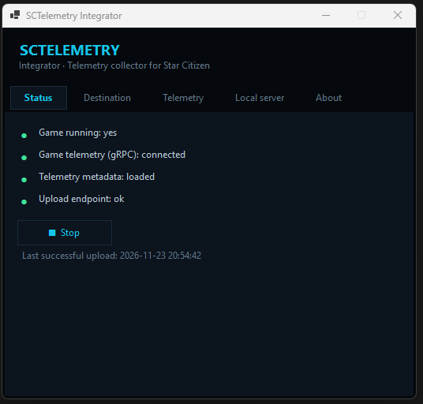
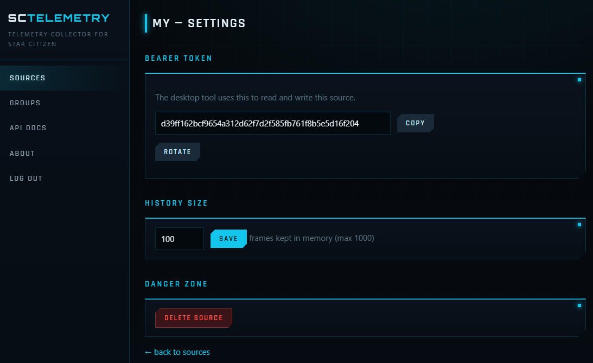
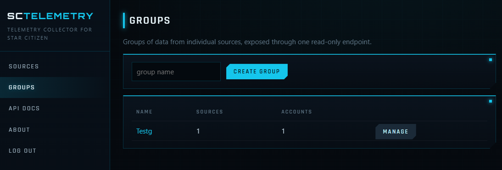

# SCTelemetry - Star Citizen Telemetry
In its alpha 5.0 release, the video game Star Citizen introduced a telemetry endpoint exposed via gRPC. This endpoint lets you access internal game data and use it in your own external tools and devices. This repository contains two tools that help you make use of this endpoint.

## SCTelemetry - Integrator
Integrator is a native, lightweight Windows application that connects directly to the game's telemetry endpoint.  
It collects the data, enriches it, and converts it into a usable, easily readable JSON format.

Once the data is polished, you can:
- forward it to any tool of your choice via HTTP (the Integrator sends the data as HTTP requests),
- start the HTTP server built into the Integrator and let your devices read the data (the Integrator acts as the server and other tools simply read from it),
- or both.

Examples of tools you could use with the Integrator:
- GameGlass
- TouchPortal
- Stream Deck
- ...

## SCTelemetry - WebApp
WebApp is a dependency-free Node.js web application with two main parts: an API and a UI.
### API
The WebApp provides API endpoints that let you publish telemetry data from the game.  
It also includes a collaboration/grouping feature: once configured, multiple game instances (multiple players) can publish their telemetry data into a single group, making it all accessible and readable from one place by anyone in that group.  
Another feature is history, which gives you the data you need to build graphs.  
To prevent leaking information to other players, both reading and publishing are protected by tokens.
### UI
The WebApp is a full-featured website whose main purpose is to manage the groups, access, and sources of the telemetry data.  
It supports login via Discord.

The WebApp stores its configuration data locally in JSON, so no database system is required.  
All telemetry data and history are stored in memory only.
